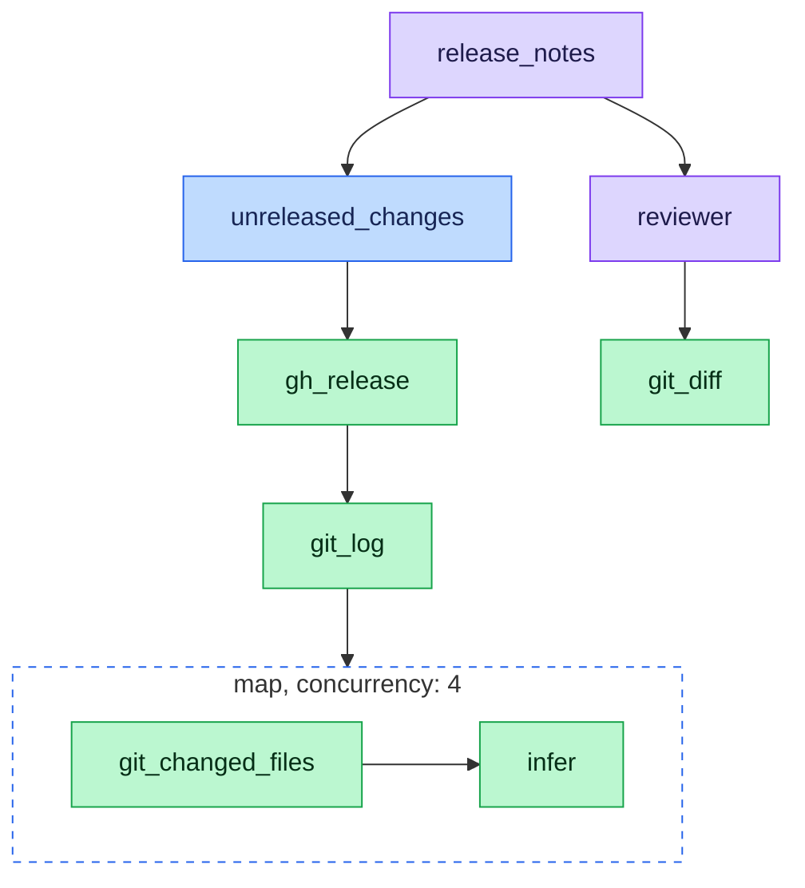

An agent is a model with instructions and a list of [tools](/tools/overview) it may call. It decides what to call at run time, one round at a time, until it can answer.

<RequestExample>

```yaml .graph/agents/release_notes.yaml
version: 1
name: release_notes
description: Writes release notes from the changes since the latest release.
model: chat
tools:
- plan__unreleased_changes
subagents:
- reviewer
system_prompt: |
  You write release notes for this repository. Before you write them, ask
  reviewer whether any change since the release is risky to ship.
```

</RequestExample>

<ResponseExample>

```yaml .graph/plans/unreleased_changes.yaml
version: 2
identifier: unreleased_changes
name: Unreleased changes
description: The commits since the latest release, each with a one-line release note.
steps:
- id: release
  tool_name: github__tool__gh_release
  input: {}
- id: commits
  tool_name: github__tool__git_log
  input:
    base: '{{release.tag}}'
    head: HEAD
- id: notes
  tool_name: map
  input:
    over: '{{commits.commits}}'
    concurrency: 4
    do:
    - id: files
      tool_name: github__tool__git_changed_files
      input:
        base: '{{item.sha}}~1'
        head: '{{item.sha}}'
        prefix: ''
    - id: note
      tool_name: builtin__infer
      input:
        instruction: |-
          Write one release-note line for this commit.
          Subject: {{item.subject}}
          Files changed: {{files.files}}
finish:
  output:
    since: '{{release.tag}}'
    notes: '{{notes.results}}'
```

</ResponseExample>

## Agent files

An agent is a YAML file in `./.graph/agents/` or `~/.config/graph/agents/`. It names a model role, the tools it may call, and its system prompt. It can also list other agents to call as subagents or hand the conversation to. See [Agent file](/agents/reference/agent-file) for every field.

## Agent networks

An agent network is any mix of agents, [plans](/plans/overview) and tools. One agent calling one plan and one subagent is already a network:



<span style={{background: "#ddd6fe", color: "#1e1b4b", padding: "2px 8px", borderRadius: "4px"}}>Agent</span> <span style={{background: "#bfdbfe", color: "#172554", padding: "2px 8px", borderRadius: "4px"}}>Plan</span> <span style={{background: "#bbf7d0", color: "#052e16", padding: "2px 8px", borderRadius: "4px"}}>Tool</span>

An agent chooses its next call each round, and each round is a model call. A plan fixes its steps ahead of time, makes no model call between them, and can run a step over many items at once. Move work an agent repeats into a plan it calls, and keep the agent for the decisions.

## Delegation

An agent can pass work to other agents in two ways. See [Build a multi-agent network](/agents/guides/multi-agent-networks) for both.

### Subagents

An agent lists the agents it can call under `subagents`, and calls each one as `agent__<name>` with a prompt. The subagent works in a fresh context and returns its result to the caller, which keeps the conversation. `reviewer` is a subagent of `release_notes`.

### Handoffs

An agent lists the agents it can hand the conversation to under `handoffs`, and hands off with `transfer_to_<name>`. The new agent takes over the conversation and answers the user from then on.

## Where agents run

| Where | How |
| --- | --- |
| Your terminal | `graph ask` for one turn, `graph chat` for a conversation |
| The workbench | Built-in agents draft and edit plans, tools and agents with you |
| A plan step | A step calls a named agent as `agent__<name>` |

A plan can also run an inline [`agent` step](/plans/reference/steps/agent), with its own prompt and tools, for one task that doesn't need its own file.

## Built-in agents

graph ships `chat`, the default for `graph ask` and `graph chat`, plus the drafters and workbench agents listed in [Built-in agents](/agents/reference/built-in-agents). An agent file with the same name replaces a built-in. A project file replaces one in your home directory, so committing `./.graph/agents/` gives your whole team the same agents.

## Guides

<CardGroup cols={2}>
  <Card title="Create an agent in the workbench" icon="wand-magic-sparkles" href="/agents/guides/create-in-workbench">
    Draft an agent with tools and save it.
  </Card>
  <Card title="Talk to an agent" icon="comments" href="/agents/guides/talk-to-an-agent">
    Ask one question or hold a conversation from the terminal.
  </Card>
  <Card title="Optimize an agent with plans" icon="gauge" href="/agents/guides/optimize-with-plans">
    Move repeated tool calls into a plan to make fewer model calls.
  </Card>
  <Card title="Build a multi-agent network" icon="diagram-project" href="/agents/guides/multi-agent-networks">
    Connect agents with handoffs and subagents.
  </Card>
  <Card title="Customize a built-in agent" icon="sliders" href="/agents/guides/customize-built-ins">
    Give the `chat` agent a researcher subagent.
  </Card>
  <Card title="Steer tool choice" icon="signs-post" href="/agents/guides/steer-tool-choice">
    Get an agent to call the right plan.
  </Card>
  <Card title="Manage threads" icon="list" href="/agents/guides/threads">
    Find, read, continue and delete conversations.
  </Card>
</CardGroup>
